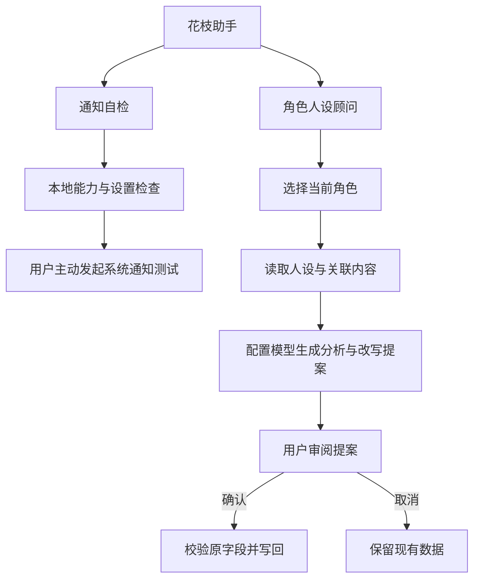

# Assistant Advisor

Feature Name: assistant-advisor
Updated: 2026-11-21

## Description

Add a notification self-check and a role-persona adviser to the existing 花枝 assistant page. Notification checks are deterministic and local. Role analysis uses the user's configured model provider and only the selected role plus its linked material. Generated changes remain proposals until the user confirms them in the UI.

## Architecture

The feature extends `pages.assistant` and its existing assistant message flow in `index.html`. It reuses the configured API selection and existing local stores. It keeps role analysis separate from the general assistant tool-calling loop so the model cannot directly mutate role data while reviewing it.



Notification self-check verifies observable capabilities. It does not run a background process and does not imply that a browser can wake after the operating system suspends or terminates the PWA. The existing Service Worker remains responsible for notification click behavior; this feature does not add a remote push server.

## Components and Interfaces

### Assistant action entry points

- Add clear entry points for `通知自检` and `角色人设顾问` to the assistant page.
- Keep both actions available on mobile and independent of chat history.
- The role-adviser entry point opens a role selector populated from current-user roles.

### Notification diagnostics

Implement a local diagnostic function that returns a display-safe snapshot:

```js
{
  notificationSupported: boolean,
  permission: 'granted' | 'denied' | 'default' | 'unsupported',
  serviceWorker: 'active' | 'registered' | 'missing' | 'unsupported',
  proactiveMessagesEnabled: boolean,
  apiConfigured: boolean
}
```

- Read `Notification.permission`, Service Worker registration state, `autoBgMsgEnabled`, and whether a user-selected API configuration is available.
- Never include API key values in this snapshot or its UI.
- Request permission only from a user-initiated permission button.
- Send test notification through the Service Worker registration's `showNotification` when possible. Explain that this verifies display on the current device only.
- Display background suspension, PWA lifecycle, and absent remote-push support as limitations rather than reporting them as successful keep-alive.

### Role adviser

- Read the selected role's `personality`, `relation`, and `quote`, plus enabled associated worldbooks and presets.
- Do not include chat history in the first version.
- Show a concise disclosure before analysis describing these data categories and that the configured model provider receives them.
- Use the existing configured API through a dedicated analysis path with tool calling disabled.
- Ask for structured analysis: strengths, evidence-backed concerns, optional field-specific proposals, and a short rationale.
- Keep the proposed field values in transient page state. Render proposals with explicit `应用建议` and `取消` actions.
- On confirmation, compare current role identity and original field values with the proposal snapshot. Apply only unchanged, explicitly confirmed fields via the local role store and `saveCharList()`.
- If a compared value changed, decline to overwrite it and offer a refreshed analysis.
- Do not execute natural-language model instructions embedded in role/worldbook/preset text as assistant tool commands; treat all selected material as analysis input.

### Existing assistant integration

- Preserve the general 花枝 conversation and existing navigation actions.
- Do not add new direct role mutation capabilities to the model tool loop for the adviser flow.
- Remove or suppress automatic permission prompting on assistant page entry so permission is requested only after a user action.

## Data Models

Pending role proposal, held in memory only:

```js
{
  roleId: string,
  roleName: string,
  changes: [
    {
      field: 'personality' | 'relation' | 'quote',
      originalValue: string,
      proposedValue: string,
      rationale: string
    }
  ]
}
```

The proposal is not persisted as role data until the user confirms. A page reload or cancellation drops the pending proposal without changing the role.

## Correctness Properties

- Notification diagnostics contain no credential values.
- Opening the assistant does not trigger a permission prompt.
- Role analysis never changes role data.
- Applying a proposal changes only confirmed fields on the same role and only when original values still match.
- Cancelling a proposal leaves the selected role unchanged.
- Analysis uses the selected role's linked enabled materials and omits unrelated roles and chat history.

## Error Handling

- Missing Notification API: show unsupported status and omit test action.
- Permission `default`: show a user-triggered permission action.
- Permission denied: explain browser/site notification settings and do not repeatedly prompt.
- Missing Service Worker: report registration unavailable; use the standard Notification API fallback only when supported and permission is granted.
- Missing model configuration or model error: report that role analysis could not run; preserve all data.
- Missing/deleted role or stale proposal: discard the proposal and ask the user to select/review the current role again.
- Notification test failure: show a concise failure and mention system-level notification settings as a possible cause.

## Test Strategy

- Unit-test diagnostic snapshots for unsupported browser APIs, permission states, missing/active Service Worker, proactive messaging enabled/disabled, and missing API configuration.
- Verify that neither diagnostics nor visible error output contains configured API key values.
- Verify that permission requests and notification display are invoked only after their explicit user actions.
- Verify that role review sends only the selected role and associated enabled material, with no chat history or unrelated role data.
- Verify that proposal generation leaves IndexedDB role data unchanged.
- Verify confirmation applies the exact approved fields, cancellation makes no change, and stale original values prevent overwrite.
- Parse all inline scripts and the Service Worker after implementation; perform mobile-layout inspection when browser tooling is available.

## References

- `index.html` — existing assistant UI, role tools, notification permission handling, proactive-message logic, and notification display.
- `sw.js` — existing notification click handling.
