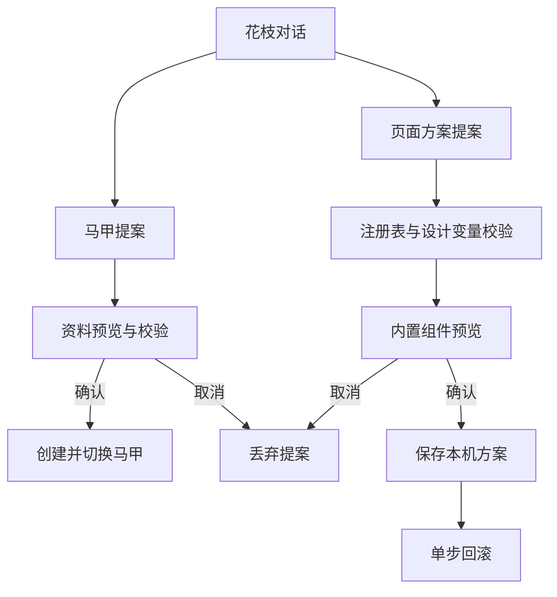

# Assistant Creative Studio

Feature Name: assistant-creative-studio
Updated: 2026-11-21

## Description

Extend the existing 花枝 assistant with reviewed persona creation and device-local interface customization. Persona proposals reuse the current persona model. Interface proposals use a versioned allowlisted configuration rendered by app-owned UI components. Both workflows keep proposed state separate from persisted state until explicit user confirmation.

## Architecture



The existing assistant tool loop in `index.html` remains the orchestration point. New tools create in-memory proposals; they do not write persona or layout stores. UI cards attached to assistant messages provide explicit confirm, cancel, and rollback interactions. The existing `create_persona` path is replaced or routed through the reviewed proposal flow so a model tool call cannot bypass confirmation.

## Components and Interfaces

### Persona proposal

- Add a proposal operation with `name`, `identity`, `personality`, and `secret` fields.
- Validate non-empty name, maximum field lengths, and duplicate names before offering confirmation.
- Hold proposal data in transient assistant state; do not persist it with the persona list before confirmation.
- On confirmation, revalidate the name, create the persona with `uid()` and `genWcId()`, call `savePersonaList()`, and switch `activePersonaId` to the new record.
- Offer avatar generation as a separate explicit action using existing image-generation configuration. Generation cancellation/failure leaves the saved persona available.

### Page component registry

Maintain an application-owned registry keyed by the supported page identifiers in Requirement 2. Each page entry defines its supported components, default ordering, required components, visibility support, and finite size/variant options. The implementation records integration points for current page renderers; a proposal cannot introduce a new renderer or executable component.

Initial shared design tokens are limited to typed values such as palette preset, accent color, surface color, base font scale, spacing scale, corner-radius scale, and card variant. Values are validated against enums or bounded color/number formats. Existing custom CSS remains managed by the existing beauty settings; assistant-generated raw CSS is not accepted as a page-layout proposal.

### Page proposal lifecycle

- Add tools to read the current registered layout and submit a structured proposal.
- Validate the schema, registered page/component ids, required component presence, uniqueness, ordering, enum values, string lengths, and serialized size.
- Render preview with the same application-owned components used by affected pages, isolated from persisted configuration.
- Snapshot each affected page's original config and version when creating the proposal.
- On confirmation, compare original snapshots with current values, apply only affected validated entries, save one previous configuration for rollback, and rerender the active page.
- On cancellation, discard transient proposal state. On stale version, retain current values and request a fresh proposal.

Suggested local data shape:

```js
{
  schemaVersion: 1,
  revision: 1,
  pages: {
    home: {
      components: [
        { id: 'featured-chat', visible: true, size: 'standard' },
        { id: 'app-grid', visible: true, size: 'standard' }
      ]
    }
  },
  tokens: {
    palette: 'sakura',
    fontScale: 'standard',
    spacing: 'comfortable',
    radius: 'soft',
    cardVariant: 'glass'
  }
}
```

Persist the current and previous configurations under dedicated local-store keys. Include schema version and provide a safe fallback to default layout when stored data fails validation.

### Assistant interaction

- Add proposal tools and their JSON schemas to `_asToolDefs`.
- Render proposal cards from typed data, escaping all text values.
- Confirm and cancel controls bind to a proposal identifier and revalidate before writing.
- Update the 花枝 system prompt with supported page names, proposal tools, confirmation behavior, local-only storage, and the no-executable-markup boundary.
- Keep ordinary conversation and existing navigation tools available.

## Data Models

Transient persona proposal:

```js
{
  id: string,
  type: 'persona',
  values: { name: string, identity: string, personality: string, secret: string },
  status: 'pending' | 'confirmed' | 'cancelled'
}
```

Transient interface proposal:

```js
{
  id: string,
  type: 'layout',
  baseRevision: number,
  affectedPages: string[],
  original: object,
  proposed: object,
  status: 'pending' | 'confirmed' | 'cancelled'
}
```

Neither proposal object is treated as persisted user configuration. Persist only validated persona records and versioned page layout data after confirmation.

## Correctness Properties

- Persona proposal and cancellation leave `personaList` and `activePersonaId` unchanged.
- Confirming a valid persona proposal creates exactly one record and activates that record.
- Duplicate or stale persona names cannot create a duplicate record.
- Every accepted layout proposal is a subset of registered pages, components, and allowed values.
- Every rendered layout originates from application-owned components.
- Layout cancellation leaves persisted configuration unchanged.
- Layout confirmation changes only the reviewed fields and only when the base revision still matches.
- Rollback restores the exact previous valid configuration.
- Invalid persisted layout falls back to defaults without affecting persona, chat, or role data.
- No model-generated string is evaluated as HTML, JavaScript, CSS source, URL, or event handler.

## Error Handling

- Missing model/API configuration: explain the requirement and keep existing state.
- Invalid persona proposal or duplicate name: show field-level feedback and request a corrected proposal.
- Invalid or oversized layout proposal: reject before preview and report the affected fields.
- Stale revision: discard the pending apply operation and request a fresh proposal.
- Local persistence error: keep the last valid layout active and report the save failure.
- Avatar generation unavailable or cancelled: keep the confirmed persona and provide the existing manual avatar editor.
- Malformed stored layout: restore registry defaults and preserve unrelated application data.

## Test Strategy

- Unit-test persona proposal validation, duplicate handling, confirmation, cancellation, activation, and avatar-generation cancellation.
- Test each page/component registry entry has unique ids, valid defaults, and required components that cannot be hidden.
- Test layout schema rejects unknown ids, unsafe value types, malformed colors, duplicate components, oversized proposals, and injected markup/script strings.
- Test preview and cancellation do not write persistent data.
- Test confirmation changes only reviewed fields; stale revision prevents overwrite; rollback restores the prior config.
- Test malformed stored data falls back to defaults and leaves other stores intact.
- Test assistant proposal cards escape all model-provided text and work at 320 CSS pixels through DOM tests where available.
- Run the existing assistant regression tests, parse inline scripts and Service Worker, and check `git diff --check`.

## References

- `index.html` — assistant tools, persona store and editor, page renderers, and beauty settings.
- `sw.js` — existing application service worker; no change is planned for this feature.
