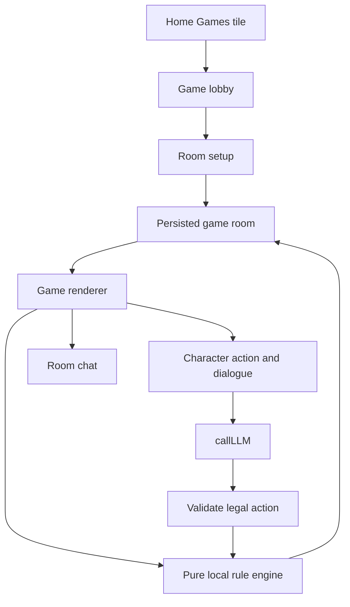

# Character Game Room

Feature Name: character-game-room
Updated: 2026-11-21

## Description

Add a home-screen Games app beside Fanfic. The first release contains three local turn-based games: Multiplayer Gomoku, Flight Chess, and Mini Monopoly. The user creates a room with eligible characters, plays user turns through touch controls, and sees character turns selected by the configured chat model. A room conversation stays attached to the game session.

## Architecture



The home launcher adds a Games tile beside the existing Fanfic tile. `pages.games` lists saved rooms and creates rooms. `pages.gameroom` renders one persisted room. Pure game helpers validate state transitions and win conditions independently from the UI. Character actions are requests to `callLLM` with bounded participant context and legal actions; only validated actions enter persisted state. The model's dialogue is plain escaped text.

Rooms are stored locally with the existing `store` abstraction. No real-time remote synchronization is included. Game-room chat is stored inside its room and never mixed into private or group chat history.

## Components and Interfaces

### Home entry and lobby

- Add a `游戏` home-screen tile adjacent to `同人`, routing to `games`.
- `pages.games` filters rooms by active persona, renders active/completed games, and opens room setup.
- Room setup selects a game type and eligible characters, validates the game's participant count, creates initial state, persists, and routes to `gameroom`.
- `pages.gameroom` renders current turn, board, legal user action affordances, action log, room chat, and leave/resume navigation.

### Room model

```js
{
  id: string,
  personaId: string,
  gameType: 'gomoku' | 'flight-chess' | 'monopoly',
  status: 'playing' | 'completed',
  participants: [{ id: string, kind: 'user' | 'character', name: string, characterId?: string, color: string }],
  currentTurn: number,
  state: object,
  chat: [{ id: string, from: string, text: string, time: string }],
  log: [{ id: string, text: string, time: string }],
  createdAt: number,
  updatedAt: number
}
```

Use a key such as `characterGameRooms`; cap the room list to the most recent 50 entries. Store room messages and event log with bounded lengths. Character participant IDs reference `charList`; persona scope uses the selected active persona at room creation.

### Multiplayer Gomoku engine

- Board is a 15-by-15 array of nullable participant indexes.
- Each turn places one mark at an empty intersection.
- Five or more contiguous marks in any of four axes wins.
- A full board with no winner is a draw.
- User selects cells. Character legal choices are empty intersections; model response proposes `{row, col, dialogue}`. On invalid response, choose the first empty cell in stable row-major order and show a fallback note.

### Flight Chess engine

- Support 2-4 participants, each with two tokens, a private base, a shared loop of 32 positions, and a six-step participant-specific home lane.
- A die roll of six launches one token from base. Movement rolls never overshoot a token's finish position.
- Landing on a shared track cell occupied by an opponent sends the opponent token back to base. Tokens in home lanes cannot be captured.
- A roll of six or a capture grants an extra turn. Completing both tokens wins.
- On a character turn, model response proposes `{tokenIndex, dialogue}` after the die result and receives only legal token choices. If invalid, choose the first legal token. The die is generated locally.

### Mini Monopoly engine

- Support 2-6 participants on a fixed 24-space ring: Start, 16 properties, 4 chance spaces, 2 fee spaces, and 1 rest space.
- Each participant starts with 1200 funds. Passing Start grants 200. Properties have fixed prices and rents.
- Landing on an unowned property offers the user a buy/pass control; characters choose through a constrained `{buy, dialogue}` response. Landing on owned property charges rent.
- Chance and fee effects are selected from fixed local tables. Negative balances cause bankruptcy; bankrupt participants leave turn order and unowned their properties.
- One solvent participant wins. A configurable turn limit ends the game with the highest-funds participant as winner to keep local sessions finite.

### Character action and conversation service

- Build prompts from selected participant's name, personality, relation, current game summary, current legal choices, and latest room messages.
- Treat character data and room chat as untrusted content. Instruct the model to return strict JSON containing only an action from the supplied choices and a short in-character line.
- Parse and validate model output. The game engine, not the model, applies state changes, dice results, costs, captures, and winner checks.
- Chat input appends the user's escaped text to room chat and asks the selected character or current character participant for a reply. Chat requests cannot mutate game state.
- Character action limits: at most one action request per character turn. After the user or a character moves, continue consecutive character turns with a bounded loop of at most six turns, then yield to the user.

## Correctness Properties

1. A room's `currentTurn` always references a seated participant while a room is playing.
2. Invalid user or model actions preserve the game state.
3. Gomoku moves only occupy empty cells; a winner has a contiguous run of at least five on one axis.
4. Flight Chess token positions remain within base, shared route, home lane, or finished states; opponent captures affect only shared cells.
5. Monopoly balances, ownership, positions, active participants, and winner status change only through validated local rules.
6. Every room mutation persists under its existing room ID, persona scope, and game type.
7. Room chat cannot modify board state, and model dialogue cannot directly inject HTML.
8. Character API failure leaves the session playable through a deterministic legal fallback.

## Error Handling

- Missing eligible characters or an invalid participant count: keep room setup open and show a specific validation message.
- Missing API configuration: permit user-controlled game turns and explain character turns need API settings.
- Malformed or illegal model action: use deterministic legal fallback and append a visible fallback event.
- Store write failure: keep the last valid in-memory room state and show a save error.
- Missing/deleted character after room restoration: retain the seat using the saved display name and use deterministic fallback behavior.
- Corrupt room data: skip the invalid room in the lobby and preserve all other application data.

## Test Strategy

- Unit-test Gomoku bounds, occupied cells, all four win axes, draw, and multi-seat turn advance.
- Unit-test Flight Chess launch, legal movement, capture, bonus turn, home lane, and completion.
- Unit-test Monopoly start salary, purchase, rent, chance/fee, bankruptcy, winner, and turn limit.
- Unit-test model response parsing, legal action validation, deterministic fallbacks, and chat/state isolation.
- Test room creation participant limits, persona filtering, save/restore, and completed-room history.
- Run the existing Node test suite, parse all inline scripts, and run `git diff --check`.

## References

- `index.html` — home screen app grid, `store`, `getMyChars`, `callLLM`, group-chat game patterns, and character records.
- `.monkeycode/specs/2026-11-21-character-game-room/requirements.md` — feature requirements.
